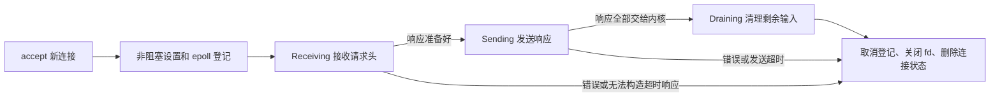

# CppServer：LT epoll HTTP 学习项目

使用 C++17、Linux 非阻塞 socket、LT epoll 和异步日志库实现的基础 HTTP 服务器。
监听 `127.0.0.1:8080`，提供 GET 文本响应，每个连接处理一次请求后关闭。

主线程通过事件循环推进连接的接收、发送和清理。日志库使用独立后台线程；线程池源码保留供后续学习，当前服务器没有创建线程池，也不链接线程池库。

## 构建与运行

需要 Linux / WSL、C++17 编译器、CMake 3.13 或更新版本和系统线程库。

```bash
cmake -S . -B build
cmake --build build -j 4
./build/main
```

另开终端验证：

```bash
curl --http1.1 -i --max-time 3 http://127.0.0.1:8080/hello
curl --http1.1 -i --max-time 3 http://127.0.0.1:8080/health
curl --http1.1 -i --max-time 3 http://127.0.0.1:8080/missing
curl --http1.1 -i --max-time 3 'http://127.0.0.1:8080/hello?name=Tom'
```

| 路径 | 状态 | 正文 | 正文字节数 |
| --- | --- | --- | --- |
| `/hello` | 200 OK | `Hello,HTTP!` 加换行 | 12 |
| `/health` | 200 OK | `OK` 加换行 | 3 |
| `/missing` | 404 Not Found | `Not Found` 加换行 | 10 |
| `/hello?name=Tom` | 200 OK | `Hello,HTTP!` 加换行 | 12 |

在服务器终端按 `Ctrl+C` 停止进程。当前没有优雅退出机制，异步日志队列中尚未写入文件的消息不保证保存。

## 事件循环和连接状态



- 监听和客户端 socket 都设置为非阻塞。LT 模式下，尚未处理完的就绪条件会继续触发通知。
- `connections` 按 fd 保存请求、响应、发送进度、阶段及截止时间，供后续事件继续处理。
- 接收阶段关注 `EPOLLIN`；发送阶段关注 `EPOLLOUT`，部分发送后从 `sentBytes` 继续；清理阶段重新关注 `EPOLLIN`。
- `EAGAIN/EWOULDBLOCK` 表示暂时没有进展，交还事件循环；`EINTR` 重试时仍检查期限。
- 事件循环在处理本批事件后扫描期限，使没有新事件的连接也能结束等待。严重错误退出前，先释放全部已管理的客户端，再关闭监听和 epoll。

## 默认配置

| 配置 | 当前值 | 位置 |
| --- | --- | --- |
| 监听地址 | `127.0.0.1:8080` | `src/tcp_server.cpp` |
| listen 等待队列参数 | 5；不是已接收连接总数限制 | `src/tcp_server.cpp` |
| 单次最多取回的就绪事件 | 16 | `src/tcp_server.cpp` |
| 单次监听事件最多 accept | 32 | `src/tcp_server.cpp` |
| epoll_wait 最长等待 | 100 ms | `src/tcp_server.cpp` |
| 接收空闲期限 | 30 秒；成功收到数据后更新 | `src/tcp_connection.cpp`、`src/tcp_server.cpp` |
| 请求头接收总期限 | 接收并初始化连接起 60 秒；不随数据延长 | 同上 |
| 发送空闲期限 | 进入 Sending 起 30 秒；部分发送成功后更新 | 同上 |
| 清理空闲期限 | 100 ms；收到待丢弃数据后更新 | `src/tcp_connection.cpp` |
| 清理总期限和字节预算 | 1 秒、64 KiB，任一耗尽就结束 | `src/tcp_connection.cpp` |
| 请求头总上限 | 8192 字节，包含请求行及结束空行 | `src/tcp_connection.cpp` |
| 请求目标上限 | 4096 字节，包含查询参数 | `src/tcp_connection.cpp` |
| 请求正文长度上限 | 0 | `src/tcp_connection.cpp` |
| 日志最低级别 | INFO | `src/main.cpp` |

所有期限使用 `steady_clock`。当前通过扫描检查期限，处理时刻会受到线程调度和当前批次处理耗时影响。
60 秒仅限制请求头接收阶段；发送和清理使用各自的期限，没有覆盖接收至响应完成全过程的统一总时限。
当前没有应用层已接收连接总数上限，旧线程池队列容量不再参与连接管理。

## HTTP 行为

- 累积分段请求，以 `\r\n\r\n` 判断请求头结束，不把一次 `recv()` 当作完整请求。
- 解析方法、原始请求目标和版本；校验方法 token、目标字符、百分号编码及目标形式。
- 解析普通路径、http 绝对 URI、CONNECT 主机与端口及 OPTIONS 星号目标；路由根据提取的路径匹配，忽略查询参数。
- 字段名转为小写，去掉字段值两端的空格和制表符，保留顺序及重复字段。
- 校验 Host 的数量和内容，包括端口、reg-name、方括号 IPv6 等。HTTP/1.1 要求一个 Host，HTTP/1.0 允许省略，重复 Host 拒绝。
- Content-Length 必须为数字且不重复；合法非零长度返回 413，因为当前不接收请求正文。
- 解析 Transfer-Encoding 的列表、参数、引号及转义；要求 chunked 唯一并位于末尾。与 Content-Length 同时出现或用于 HTTP/1.0 时拒绝；语法通过后仍返回 501，因为尚无正文解码器。
- GET 用于实际路由；已知但不允许的方法返回 405 和 `Allow: GET`，未知合法方法返回 501。HEAD 的错误响应不发送正文，当前省略 Content-Length。
- 接受语法合法的 HTTP/1.x；HTTP/1.0 使用 1.0 响应，其余使用 1.1 响应；其他主版本返回 505。
- 解析失败返回 400，未知路径返回 404。目标超限返回 414，能够提前确认时在请求行完整前拒绝。
- 请求头超限、接收超时或提前 EOF 时，根据已有请求行条件尝试准备 431、408 或 400；没有可用请求行时直接释放连接。
- 响应模块生成状态行、Date、Content-Type、Content-Length 和 `Connection: close`。正文长度按字节计算，Date 为英文 UTC 日期，生成失败时省略。
- 非阻塞发送处理部分发送、EINTR、EAGAIN 和等待超时，使用 `MSG_NOSIGNAL`。发送超时直接释放连接，不在已发送的响应后追加新错误响应。
- 响应发完后先 `shutdown(SHUT_WR)`，再有界清理剩余输入，最后关闭连接。达到清理预算时可能出现 TCP RST，不保证任意过量输入都以 FIN 结束。
- 日志记录启动、连接、请求和错误，系统调用失败后保存对应 errno；支持异步写入和按大小滚动。

## 重复运行验收

除构建工具外，只需 Python 3 标准库。在项目目录运行：

```bash
python3 tests/run_epoll_checks.py --report tests/reports/epoll-latest.json
```

默认在独立临时目录重新构建，开启 `_GLIBCXX_ASSERTIONS` 和 UBSan，运行全部 11 组检查。
30 秒接收、发送空闲期限和 60 秒请求头总期限均真实等待，超时分组并行执行。
测试使用临时回环端口，不要求停止用户在 8080 上的服务，只关闭测试自己创建的连接和进程。

```bash
python3 tests/run_epoll_checks.py --skip-timeouts
python3 tests/run_epoll_checks.py --only concurrency
```

跳过超时或只选部分分组时不算完整验收。覆盖范围、故障注入和大响应测试的具体边界见 [tests/README.md](tests/README.md)，最新完整验收记录见 [tests/EPOLL_BASELINE.md](tests/EPOLL_BASELINE.md)。

## 模块结构

| 模块 | 职责 |
| --- | --- |
| `src/main.cpp` | 初始化日志，调用服务器入口 |
| `include/tcp_server.h`、`src/tcp_server.cpp` | 监听、epoll 登记与分发、连接容器、期限扫描和最终资源释放 |
| `include/tcp_connection.h`、`src/tcp_connection.cpp` | 连接状态、非阻塞收发、请求处理、期限检查和有界清理 |
| `include/http_request.h`、`src/http_request.cpp` | 请求行和字段解析、Host、长度及传输编码校验 |
| `include/http_router.h`、`src/http_router.cpp` | 方法与路径选择 |
| `include/http_response.h`、`src/http_response.cpp` | HTTP 日期、状态行、响应头及正文组装 |
| `include/logger.h`、`src/logger.cpp` | 异步日志及文件滚动 |
| `include/thread_pool.h`、`src/thread_pool.cpp` | 保留的线程池库；当前网络入口未使用 |
| `tests/run_epoll_checks.py`、`tests/http_test_support.py` | 当前验收入口及共享收发、响应断言工具 |
| `tests/http_cases.json` | 122 个原始 HTTP 字节用例及预期响应 |
| `tests/epoll_*.cpp`、`tests/socket_test_shim.cpp` | 默认关闭的测试探针、端口映射及显式故障注入 |
| `tests/history/` | 旧 Echo、请求头接收及阻塞式 HTTP 测试归档 |

正常构建只生成服务器及日志依赖。需要单独学习线程池或非阻塞接收实验时：

```bash
cmake --build build --target thread_pool
cmake --build build --target nonblocking_recv
```

验收脚本通过 `CPPSERVER_BUILD_EPOLL_TEST_TOOLS=ON` 启用测试目标，正常运行不需要开启。

## 查看日志

日志相对于进程启动目录写入 `server.log`。从项目目录运行 `./build/main` 后：

```bash
tail -n 30 server.log
```

若先进入 `build` 再执行 `./main`，则查看 `build/server.log`。
日志附带时间、级别、线程编号和源码位置；fd 会被复用，不能作为永久连接身份。
日志库初始化失败输出到终端，日志队列满时会丢弃新消息。

## 阶段范围

当前 LT epoll 版本提供 GET 文本服务、错误处理、连接期限和可重复验收。
未实现非零长度请求正文、chunked 解码、成功的 HEAD、keep-alive、pipelining、静态文件服务、优雅退出或长期压力测试。
ET 模式、更完整的 Reactor 封装以及把耗时业务交给线程池，留作后续学习阶段。
