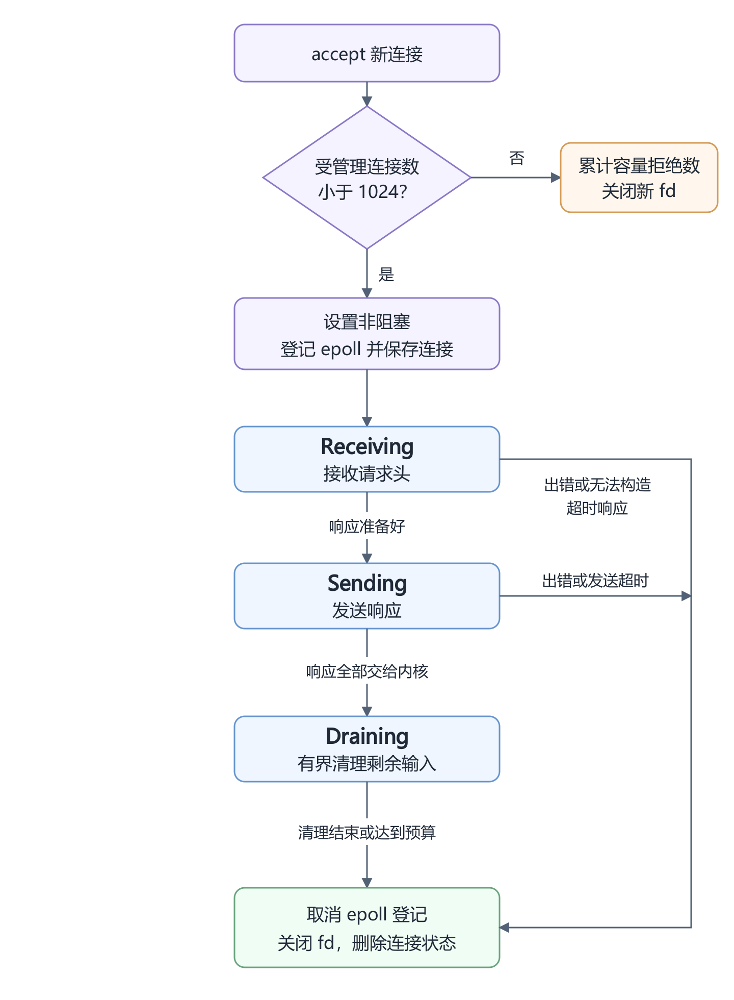

# CppServer：LT epoll HTTP 学习项目

使用 C++17、Linux 非阻塞 socket、LT epoll 和异步日志库实现的基础 HTTP 服务器。
监听 `127.0.0.1:8080`，提供 GET 文本响应，每个连接处理一次请求后关闭。

主线程通过事件循环推进连接的接收、发送和清理。日志库使用独立后台线程；线程池源码保留供后续学习，当前服务器没有创建线程池，也不链接线程池库。

当前已实现 1024 个受管理连接的容量限制、SIGINT/SIGTERM 优雅退出，以及不输出查询参数和请求头字段值的简要请求日志。
accept 支持连接/网络错误分类，以及 EMFILE/ENFILE/ENOBUFS/ENOMEM 下的暂停接收和定时重试；连续可恢复错误达到 32 次也会暂停。日志时间转换失败时保留正文并使用 `time-unavailable` 占位。
2026-11-16 的完整功能验收通过 16 组检查，其中 accept 恢复专项扩展到 39 项，覆盖连续错误退避、资源不足及恢复。独立 Release 性能测量保留 2026-11-15 的 16 次记录。当前版本定位为可复现、可继续扩展的 Linux 网络编程学习项目。

## 构建与运行

需要 Linux / WSL、C++17 编译器、CMake 3.13 或更新版本和系统线程库。

```bash
cmake -S . -B build
cmake --build build -j 4
./build/main
```

另开终端验证：

```bash
curl --http1.1 -i --max-time 3 http://127.0.0.1:8080/hello
curl --http1.1 -i --max-time 3 http://127.0.0.1:8080/health
curl --http1.1 -i --max-time 3 http://127.0.0.1:8080/missing
curl --http1.1 -i --max-time 3 'http://127.0.0.1:8080/hello?name=Tom'
```

| 路径 | 状态 | 正文 | 正文字节数 |
| --- | --- | --- | --- |
| `/hello` | 200 OK | `Hello,HTTP!` 加换行 | 12 |
| `/health` | 200 OK | `OK` 加换行 | 3 |
| `/missing` | 404 Not Found | `Not Found` 加换行 | 10 |
| `/hello?name=Tom` | 200 OK | `Hello,HTTP!` 加换行 | 12 |

在服务器终端按 `Ctrl+C`，或向服务器进程发送 `SIGTERM`，进入优雅退出：

1. 从 epoll 删除监听登记，停止接收新连接。
2. 继续推进已有连接的接收、发送和清理，最多给予 5 秒等待时间。
3. 连接提前全部结束时立即收尾；到达期限时记录剩余数量并主动关闭，再释放监听、epoll 和信号 fd。
4. 正常退出经过日志库析构，等待后台线程处理剩余日志并关闭文件。

重复退出信号不会延长 5 秒期限。该期限约束已有连接的等待阶段，事件循环扫描、线程调度和日志收尾会影响最终退出时间。
等待期间监听 socket 尚未关闭，客户端的 TCP 握手仍可能成功，但新连接不会进入应用处理流程。

## 事件循环和连接状态

从上到下阅读。右侧分支表示容量拒绝或连接出错后的处理；accept 错误分类和重试规则见下方说明。

[](docs/images/connection-lifecycle.svg)

点击图片可查看矢量原图。

- 监听和客户端 socket 都设置为非阻塞。LT 模式下，尚未处理完的就绪条件会继续触发通知。
- `connections` 按 fd 保存请求、响应、发送进度、阶段及截止时间，供后续事件继续处理。
- 接收阶段关注 `EPOLLIN`；发送阶段关注 `EPOLLOUT`，部分发送后从 `sentBytes` 继续；清理阶段重新关注 `EPOLLIN`。
- `EAGAIN/EWOULDBLOCK` 表示暂时没有进展，交还事件循环；`EINTR` 重试时仍检查期限。
- accept 的连接/网络错误记录警告，连续次数不足上限时结束本轮接收；EINTR 在本轮调用预算内重试。连续可恢复错误达到 32 次，或出现 EMFILE/ENFILE/ENOBUFS/ENOMEM 时，删除监听登记，一秒后尝试重新登记。成功接收、EAGAIN/EWOULDBLOCK 或进入暂停后清零连续错误计数；暂停期间继续处理已有客户端，退出期间不再恢复接收。
- 事件循环在处理本批事件后扫描期限，使没有新事件的连接也能结束等待。严重错误退出前，先释放全部已管理的客户端，再关闭监听和 epoll。
- `main()` 在创建日志线程前屏蔽 SIGINT/SIGTERM，再创建非阻塞 signalfd 并交给事件循环监听。退出请求以可读事件进入同一条事件处理路径。
- 停止状态只设置一次退出截止时间。等待期间已有客户端继续按 Receiving、Sending、Draining 三个阶段处理。

## 默认配置

| 配置 | 当前值 | 位置 |
| --- | --- | --- |
| 监听地址 | `127.0.0.1:8080` | `src/tcp_server.cpp` |
| listen 等待队列参数 | 5；不是已接收连接总数限制 | `src/tcp_server.cpp` |
| 应用层连接容量 | 1024；包含 Receiving、Sending 和 Draining | `src/tcp_server.cpp` |
| 容量拒绝日志 | 第 1 次及累计每 100 次记录 WARN | `src/tcp_server.cpp` |
| 优雅退出等待期限 | 第一次退出信号起 5 秒；重复信号不延长 | `src/tcp_server.cpp` |
| 单次最多取回的就绪事件 | 16 | `src/tcp_server.cpp` |
| 单次监听事件最多调用 accept | 32；成功、失败和 EINTR 都计入 | `src/tcp_server.cpp` |
| 连续可恢复 accept 错误上限 | 32；跨监听事件累计，达到后暂停接收 | `src/tcp_server.cpp` |
| epoll_wait 最长等待 | 100 ms | `src/tcp_server.cpp` |
| accept 暂停重试间隔 | 至少 1 秒，达到期限后由事件循环重新登记监听 fd | `src/tcp_server.cpp` |
| 接收空闲期限 | 30 秒；成功收到数据后更新 | `src/tcp_connection.cpp`、`src/tcp_server.cpp` |
| 请求头接收总期限 | 接收并初始化连接起 60 秒；不随数据延长 | 同上 |
| 发送空闲期限 | 进入 Sending 起 30 秒；部分发送成功后更新 | 同上 |
| 清理空闲期限 | 100 ms；收到待丢弃数据后更新 | `src/tcp_connection.cpp` |
| 清理总期限和字节预算 | 1 秒、64 KiB，任一耗尽就结束 | `src/tcp_connection.cpp` |
| 请求头总上限 | 8192 字节，包含请求行及结束空行 | `src/tcp_connection.cpp` |
| 请求目标上限 | 4096 字节，包含查询参数 | `src/tcp_connection.cpp` |
| 请求正文长度上限 | 0 | `src/tcp_connection.cpp` |
| 日志最低级别 | INFO | `src/main.cpp` |
| 日志共享队列容量 / 批大小 | 10000 条 / 100 条 | `include/logger.h` |
| 日志滚动 | 单文件 10 MiB，最多 3 个归档文件 | `include/logger.h` |

所有期限使用 `steady_clock`。当前通过扫描检查期限，处理时刻会受到线程调度和当前批次处理耗时影响。
60 秒仅限制请求头接收阶段；发送和清理使用各自的期限，没有覆盖接收至响应完成全过程的统一总时限。
应用层容量检查发生在 accept 成功后、客户端登记和保存之前。满额时立即关闭新 fd；旧线程池队列容量不参与连接管理。
地址、端口、backlog、容量和各项期限目前仍是源码中的默认值，尚无命令行或配置文件入口。

## HTTP 行为

- 累积分段请求，以 `\r\n\r\n` 判断请求头结束，不把一次 `recv()` 当作完整请求。
- 解析方法、原始请求目标和版本；校验方法 token、目标字符、百分号编码及目标形式。
- 解析普通路径、http 绝对 URI、CONNECT 主机与端口及 OPTIONS 星号目标；路由根据提取的路径匹配，忽略查询参数。
- 字段名转为小写，去掉字段值两端的空格和制表符，保留顺序及重复字段。
- 校验 Host 的数量和内容，包括端口、reg-name、方括号 IPv6 等。HTTP/1.1 要求一个 Host，HTTP/1.0 允许省略，重复 Host 拒绝。
- Content-Length 必须为数字且不重复；合法非零长度返回 413，因为当前不接收请求正文。
- 解析 Transfer-Encoding 的列表、参数、引号及转义；要求 chunked 唯一并位于末尾。与 Content-Length 同时出现或用于 HTTP/1.0 时拒绝；语法通过后仍返回 501，因为尚无正文解码器。
- GET 用于实际路由；已知但不允许的方法返回 405 和 `Allow: GET`，未知合法方法返回 501。HEAD 的错误响应不发送正文，当前省略 Content-Length。
- 接受语法合法的 HTTP/1.x；HTTP/1.0 使用 1.0 响应，其余使用 1.1 响应；其他主版本返回 505。
- 解析失败返回 400，未知路径返回 404。目标超限返回 414，能够提前确认时在请求行完整前拒绝。
- 请求头超限、接收超时或提前 EOF 时，根据已有请求行条件尝试准备 431、408 或 400；没有可用请求行时直接释放连接。
- 响应模块生成状态行、Date、Content-Type、Content-Length 和 `Connection: close`。正文长度按字节计算，Date 为英文 UTC 日期，生成失败时省略。
- 非阻塞发送处理部分发送、EINTR、EAGAIN 和等待超时，使用 `MSG_NOSIGNAL`。发送超时直接释放连接，不在已发送的响应后追加新错误响应。
- 响应发完后先 `shutdown(SHUT_WR)`，再有界清理剩余输入，最后关闭连接。达到清理预算时可能出现 TCP RST，不保证任意过量输入都以 FIN 结束。
- 日志记录启动、连接、请求和错误，系统调用失败后保存对应 errno；支持异步写入和按大小滚动。正常请求摘要包含方法、去掉查询参数的路径、版本和 fd，不输出完整请求目标或请求头字段值。

## 重复运行验收

除构建工具外，只需 Python 3 标准库。在项目目录运行：

```bash
python3 tests/run_epoll_checks.py --report tests/reports/epoll-latest.json
```

容量组需要同时持有 1024 个客户端及额外描述符，建议测试进程的 fd 软上限至少为 2048。可用 `ulimit -Sn`、`ulimit -Hn` 查看软硬上限；测试服务器会继承该限制。

默认在独立临时目录重新构建，开启 `_GLIBCXX_ASSERTIONS` 和 UBSan，运行全部 16 组检查。
真实 fd 耗尽场景另用独立 Release + assertions 构建，避免检测运行库自身需要额外 fd 的影响；具体对照和边界见测试说明。
30 秒接收、发送空闲期限和 60 秒请求头总期限均真实等待，超时分组并行执行。
测试使用临时回环端口，不要求停止用户在 8080 上的服务，只关闭测试自己创建的连接和进程。

```bash
python3 tests/run_epoll_checks.py --skip-timeouts
python3 tests/run_epoll_checks.py --only concurrency
```

跳过超时或只选部分分组时不算完整验收。原有 122 项 HTTP 字节用例之外，当前验收还覆盖连接容量、敏感日志、真实信号退出和重复信号等场景。
覆盖范围、故障注入和大响应测试的具体边界见 [tests/README.md](tests/README.md)，当前完整验收记录见 [tests/ACCEPT_BACKOFF_BASELINE.md](tests/ACCEPT_BACKOFF_BASELINE.md)，原始结果见 [功能报告](tests/reports/epoll-accept-backoff-2026-11-16.json)。

## 本机性能基线

```bash
python3 tests/run_epoll_benchmark.py --report tests/reports/epoll-performance-latest.json
```

脚本独立构建 Release 版本，对 `/health`、`/hello` 运行 1、16、64 并发短连接，并补充等待连接和满容量场景。默认每次预热 0.5 秒、发压 3 秒、重复两次；保留 INFO 异步文件日志及生产收发策略。

2026-11-15 在 AMD Ryzen 9 7940HX 的 Linux / WSL 回环网络上测得：

| 场景 | 并发请求数 | 两次成功 QPS 范围 | 两次 p99 延迟范围 |
| --- | ---: | ---: | ---: |
| `/health` | 64 | 4028～4122 | 10.55～12.16 ms |
| `/hello` | 64 | 4062～4128 | 11.00～11.50 ms |
| 256 个等待连接下请求 `/health` | 64 | 3961～4105 | 11.76～11.98 ms |

正常测量共校验 179282 个完整响应，请求错误为 0。全部 16 次测量的日志丢弃数均为 0；各场景结束后 fd 恢复基线。
1024 个名额已满的两次测量均按预期拒绝新请求，拒绝不计入成功 QPS；释放名额后健康请求恢复正常。

延迟包含建连、完整响应、服务器 FIN 和本地连接清理，吞吐量也计入最后一批在途请求完成所需的时间。
客户端与服务器同机运行，Python asyncio 发压端及当前 backlog 可能限制负载。这是短时本机基线，尚未测出服务器极限或验证长期生产容量。
完整参数、CPU/RSS/fd、日志统计和源码哈希见 [本轮记录](tests/RECOVERY_BASELINE.md) 及 [原始报告](tests/reports/epoll-performance-2026-11-15.json)。历史性能记录保留在 [tests/PERFORMANCE_BASELINE.md](tests/PERFORMANCE_BASELINE.md)。
上述性能结果对应 2026-11-15 的输入快照；本轮 accept 错误处理修改后尚未重测性能。

## 模块结构

| 模块 | 职责 |
| --- | --- |
| `src/main.cpp` | 准备退出信号、初始化日志、创建并持有 signalfd，调用服务器入口 |
| `include/tcp_server.h`、`src/tcp_server.cpp` | 监听、epoll 登记与分发、连接容量、期限扫描、优雅退出和最终资源释放 |
| `include/tcp_connection.h`、`src/tcp_connection.cpp` | 连接状态、非阻塞收发、请求处理、期限检查和有界清理 |
| `include/http_request.h`、`src/http_request.cpp` | 请求行和字段解析、Host、长度及传输编码校验 |
| `include/http_router.h`、`src/http_router.cpp` | 方法与路径选择 |
| `include/http_response.h`、`src/http_response.cpp` | HTTP 日期、状态行、响应头及正文组装 |
| `include/logger.h`、`src/logger.cpp` | 异步日志及文件滚动 |
| `include/thread_pool.h`、`src/thread_pool.cpp` | 保留的线程池库；当前网络入口未使用 |
| `tests/run_epoll_checks.py`、`tests/http_test_support.py` | 当前验收入口及共享收发、响应断言工具 |
| `tests/epoll_hardening_checks.py` | 容量、日志隐私和优雅退出检查 |
| `tests/accept_recovery_checks.py`、`tests/logger_time_checks.cpp` | accept 分类、资源不足暂停与恢复、真实 fd 耗尽，以及日志时间失败与恢复检查 |
| `tests/run_epoll_benchmark.py` | Release 短连接性能测试、资源统计及环境记录 |
| `tests/logger_stats_probe.cpp` | 测试时在生产事件循环返回后导出日志统计 |
| `tests/http_cases.json` | 122 个原始 HTTP 字节用例及预期响应 |
| `tests/epoll_*.cpp`、`tests/socket_test_shim.cpp` | 默认关闭的测试探针、端口映射及显式故障注入 |
| `tests/history/` | 旧 Echo、请求头接收及阻塞式 HTTP 测试归档 |

正常构建只生成服务器及日志依赖。需要单独学习线程池或非阻塞接收实验时：

```bash
cmake --build build --target thread_pool
cmake --build build --target nonblocking_recv
```

验收脚本通过 `CPPSERVER_BUILD_EPOLL_TEST_TOOLS=ON` 启用测试目标，正常运行不需要开启。

## 查看日志

日志相对于进程启动目录写入 `server.log`。从项目目录运行 `./build/main` 后：

```bash
tail -n 30 server.log
```

若先进入 `build` 再执行 `./main`，则查看 `build/server.log`。
日志附带时间、级别、线程编号和源码位置；fd 会被复用，不能作为永久连接身份。
本地时间转换失败时，时间字段显示 `[time-unavailable]`，该条日志的级别、正文及源码位置仍然保留。
日志库初始化失败输出到终端，日志队列满时会丢弃新消息。
当前请求摘要示例：

```text
方法=GET,路径=/hello,版本=HTTP/1.1,fd=7
```

响应状态码、请求耗时及稳定的连接编号尚未加入统一访问日志；日志丢弃计数和队列峰值目前由性能测试探针导出，主程序尚未定期报告。

## 阶段范围

当前 LT epoll 版本提供 GET 文本服务、错误处理、连接期限、应用层连接容量、优雅退出和可重复的功能及性能测试。
未实现非零长度请求正文、chunked 解码、成功的 HEAD、keep-alive、pipelining、静态文件服务、TLS 或长期压力测试。
ET 模式、更完整的 Reactor 封装以及把耗时业务交给线程池，留作后续学习阶段。

应用层 1024 容量限制不能替代操作系统 fd 上限。当前遇到 EMFILE/ENFILE/ENOBUFS/ENOMEM 会暂停接收并定时重试；这不会提高系统资源上限，也不保证等待队列中的任意客户端都能及时接入。连续可恢复错误也有暂停退避；其他未分类的 accept 错误和监听登记操作失败仍按服务器级错误清理并退出。

后续工程改进重点包括集中配置、访问日志补全，以及用 RAII 简化描述符所有权和错误清理。
